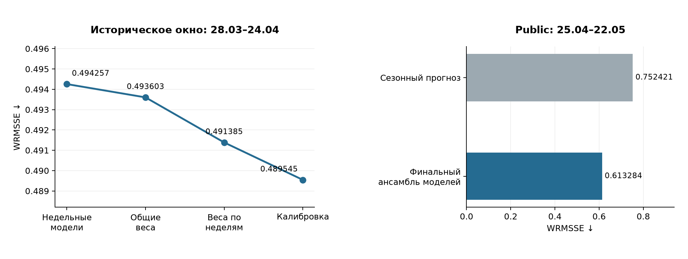

# Demand Planner · M5 Forecasting

Прогноз ежедневных продаж Walmart на 28 дней: **30 490 рядов «товар — магазин»**, десять магазинов, три категории. Финальное решение — две общие модели LightGBM и четыре модели по неделям горизонта.

**Private WRMSSE: 0.58009 — 60-е место из [5 558 команд](https://www.kaggle.com/c/m5-forecasting-accuracy/discussion/163414), топ 1.08% исторического рейтинга M5 на Kaggle.**

[Скачать модели и результаты](https://github.com/dannya220/demand-planner/releases/tag/v1.0.0) · [Финальный notebook](notebooks/10_final_submission.ipynb) · [Параметры ансамбля моделей](results/m5_wrmsse/final_m5_frozen_ensemble_v1/frozen_recipe.json)

## Результат

| Период | WRMSSE ↓ | Bias | Как получена оценка |
|---|---:|---:|---|
| Исторический: 28 марта — 24 апреля 2016 | 0.489545 | +0.21% | Окно подбора параметров и ансамбля моделей |
| Public: 25 апреля — 22 мая | 0.613284 | −4.42% | Локальный расчёт по public-фактам |
| Private: 23 мая — 19 июня | **0.58009** | — | Поздняя отправка на Kaggle |

На public-периоде среднее по дням недели за последние четыре недели даёт **0.752421**. Финальный ансамбль моделей уменьшил ошибку на **18.49%**. Прогноз без калибровки получил **0.627435**.

Историческое окно многократно использовалось при разработке. Public тоже рассматривался в ранних экспериментах. Поэтому значения разных периодов приведены отдельно. Private score записан после отправки файла; его SHA-256 сохранён в [протоколе submission](results/m5_wrmsse/final_m5_frozen_ensemble_v1/submission_manifest.json).



## Финальное решение

Прогноз строится сразу на 28 дней. У общих моделей дата отсчёта и горизонт входят в признаки. Каждый недельный специалист обучается на семи горизонтах своей недели.

Используются **67 признаков**:

- средние, лаги, разброс и динамика прошлых продаж;
- доля дней с продажами, давность последней продажи и размер ненулевых покупок;
- календарь и SNAP;
- история цены и известная цена целевой недели;
- продажи отдела в магазине;
- история того же товара в остальных магазинах.

Продажи для признаков ограничены датой отсчёта. Календарь и будущие недельные цены доступны в данных M5. Для применения к другому бизнесу ценовые признаки потребуют известного плана цен.

| Модель | Деревьев | Обучающие пары дат |
|---|---:|---|
| Общая trial 9 | 197 | 52 даты отсчёта × 28 горизонтов |
| Общая trial 5 | 471 | 52 × 8 |
| Специалист недели 1 | 2076 | 52 × 7 |
| Специалист недели 2 | 196 | 52 × 7 |
| Специалист недели 3 | 216 | 52 × 7 |
| Специалист недели 4 | 93 | 52 × 7 |

На каждой паре дат используются все 30 490 рядов. Число **52** означает еженедельные даты отсчёта примерно за год. Более ранние продажи также доступны для исторических признаков.

Веса до калибровки:

| Неделя прогноза | Общая trial 9 | Общая trial 5 | Специалист недели |
|---|---:|---:|---:|
| 1 | 15% | 45% | 40% |
| 2 | 0% | 0% | 100% |
| 3 | 12.5% | 37.5% | 50% |
| 4 | 0% | 0% | 100% |

Прогноз ансамбля моделей умножается на **1.006**. Коэффициент выбран по WRMSSE. Число деревьев, параметры, веса и калибровка зафиксированы до финальных обучений.

Для public модели обучались с историей до **24 апреля**, для private — до **22 мая 2016**. Всего сохранено **12 моделей**. Полный запуск на Kaggle CPU занял **3 ч 52 мин**, включая подготовку и сохранение.

## Как развивался проект

### Основные идеи

**От простого прогноза к общей модели.** Начали со среднего прошлых недель, чтобы получить ориентир качества. Затем CatBoost объединил историю продаж, календарь и категории товаров. После недельного пилота перешли к ежедневным продажам всех магазинов и WRMSSE, которая учитывает ошибки на разных уровнях: от отдельного товара в магазине до общей суммы продаж.

**Почему LightGBM.** Нужна была вторая модель для сравнения с CatBoost и экспериментов на десятках миллионов строк. LightGBM обучался быстрее в наших запусках, поэтому позволял проверять больше вариантов данных и гиперпараметров. Число деревьев выбирали по целевой WRMSSE: остановка по Tweedie выбирала слишком раннюю итерацию.

**Больше обучающих примеров.** Для каждой из 52 дат отсчёта постепенно увеличивали число прогнозируемых горизонтов: 2, 4, 8, 16 и 28 дней. Так модель получала больше примеров связи между известной историей и будущими продажами. Дополнительно использовали доступную в M5 цену целевой недели. Рост выборки помог LightGBM, но не гарантировал улучшение: отдельные варианты уступали более редкой выборке.

**Зачем недельные специалисты.** Одна общая модель одновременно решает задачи прогноза на завтра и на четыре недели вперёд. Предположили, что этим задачам нужны разные закономерности и сложность модели. Разделили горизонт на недели 1–7, 8–14, 15–21 и 22–28 дней и обучили четыре отдельных LightGBM. Для каждой выбрали число деревьев по качеству; первой неделе понадобилось заметно больше деревьев, чем остальным.

**Зачем ансамбль и калибровка.** Общие модели и недельные специалисты дают разные прогнозы. Проверили их взвешенные комбинации и выбрали веса отдельно для каждой недели. На второй и четвёртой неделях лучшим оказался только специалист; на первой и третьей помогли общие модели. После выбора весов подобрали один множитель прогноза по WRMSSE — 1.006. Он улучшил оценку на историческом окне.

### Этапы и результаты

| Этап | Что проверялось | Результат |
|---|---|---|
| [01 · Недельный пилот](notebooks/01_exploration.ipynb) | 100 товаров FOODS, EDA, простые методы и CatBoost | MAE 4.21 против 4.28 у среднего четырёх недель |
| [02 · Весь CA_1](notebooks/02_scaling.ipynb) | 3 049 товаров, признаки, четыре временных окна и поиск лучших гиперпараметров | MAE 3.5512 против 3.8097; выигрыш 6.79% |
| [03 · Дневной M5](notebooks/03_kaggle_wrmsse.ipynb) | Все магазины, WRMSSE по 12 уровням, CatBoost и блоки признаков | Локальный public WRMSSE 0.63673 |
| [04 · LightGBM и плотность](notebooks/04_kaggle_training.ipynb) | Выбор деревьев по WRMSSE, больше обучающих пар, цена целевой недели | Исторический WRMSSE 0.53079 на 52 × 16 |
| [05 · Optuna на 52 × 8](notebooks/05_optuna_cpu.ipynb) | Поиск лучших гиперпараметров LightGBM на 52 × 8 | 0.506104 против контроля 0.538018 |
| [06 · Плотность и первые ансамбли моделей](notebooks/06_validation_and_density.ipynb) | 52 × 16/28, два дополнительных окна на плотности 8, ансамбли моделей с CatBoost | 0.501959 у trial 9 на 28; 0.500879 у ансамбля моделей 70 / 30 |
| [07 · Optuna на 52 × 28](notebooks/07_optuna_52x28.ipynb) | Поиск лучших гиперпараметров LightGBM на 52 × 28 | Контроль остался лучшим: 0.501959 |
| [08 · Недельные специалисты](notebooks/08_horizon_week_models.ipynb) | Четыре модели; отдельное увеличение лимита первой недели | 0.495382 → 0.494257 после замены первой недели |
| [09 · Ансамбль моделей и калибровка](notebooks/09_horizon_ensemble.ipynb) | Постоянные веса, веса по неделям и один множитель | 0.491385 без калибровки; **0.489545** после неё |
| [10 · Финальный прогноз](notebooks/10_final_submission.ipynb) | Два обучения по периодам, фиксированный рецепт, submission | Public 0.613284; private **0.58009** |

Дневные числа в строках 04–09 относятся к одному историческому окну **28 марта — 24 апреля**. Результаты недельного пилота и CA_1 измеряются другой метрикой и напрямую с ними не сравниваются.

### Что не оставили в решении

- **Остановка LightGBM по Tweedie.** Выбрала 52 дерева и WRMSSE 0.95840. Выбор по WRMSSE на том же окне дал 386 деревьев и 0.55498.
- **Больше строк для CatBoost.** На 52 × 4 ошибка выросла относительно его контроля 52 × 2. Позже CatBoost получил нулевой вес в проверенных ансамблях моделей.
- **EWMA.** 0.53081 против 0.53079 у модели с ценой.
- **Короткие лаги 7/14/21.** Проверенный вариант получил около 0.53230; в финальные признаки не вошёл.
- **Trial 5 на плотности 28.** Обучалась и участвовала в подборе ансамбля моделей, но её итоговый вес равен нулю.

При переносе CatBoost с macOS на Kaggle обнаружилось расхождение `price_relative_std_13w`. В двух проверенных срезах признаки совпали после отключения Bottleneck. В последующих запусках установлено `compute.use_bottleneck=False`; версии среды фиксируются в протоколах.

## Модели и воспроизведение

В [Release v1.0.0](https://github.com/dannya220/demand-planner/releases/tag/v1.0.0) доступны:

- **`demand-planner_models_v1.zip`** — 12 моделей LightGBM, рецепт, параметры и планы обучения;
- **`demand-planner_final_checkpoint.zip`** — модели, сохранённые прогнозы, public-метрики и полный submission;
- **`submission.csv.gz`** — файл отправки, сжатый без изменения содержимого;
- **`demand-planner_research_forecasts_v1.zip`** — исторические прогнозы для повторения подбора ансамбля моделей в notebook 09.

Файлы моделей хранятся в GitHub Release. В Git остаются [манифест с SHA-256](models/manifest.json), рецепт, код, ноутбуки и небольшие таблицы. Исходные данные M5 и кеши обучения в репозиторий не включены.

**Финальное обучение:** загрузить [notebook 10](notebooks/10_final_submission.ipynb) на Kaggle, подключить [M5 Forecasting — Accuracy](https://www.kaggle.com/competitions/m5-forecasting-accuracy/data), выбрать CPU и выполнить Save & Run All. При подключённом финальном checkpoint готовые компоненты проверяются и пропускаются.

Среда выполненного запуска: **Python 3.13.15, LightGBM 4.6.0, NumPy 2.1.3, pandas 2.3.3, SciPy 1.16.3**, четыре потока. Параметры и границы истории находятся в [протоколах](results/m5_wrmsse/final_m5_frozen_ensemble_v1).

После распаковки моделей в корень проекта их целостность можно проверить без LightGBM и без запуска обучения:

```bash
python scripts/verify_models.py .
```

Для локальных недельных экспериментов:

```bash
python3.12 -m venv .venv
source .venv/bin/activate
python -m pip install -r requirements.txt
python -m unittest discover -s tests
jupyter lab
```

## Структура

В Git хранятся код, ноутбуки, параметры и небольшие отчёты. Модели и полные прогнозы скачиваются из Release; исходные данные M5 подключаются отдельно.

```text
demand-planner/
├── README.md                          # результат, идеи и запуск проекта
├── requirements.txt                   # окружение локальных экспериментов
├── requirements-kaggle.txt            # версии библиотек финального запуска
│
├── notebooks/
│   ├── 01_exploration.ipynb           # EDA, 100 товаров, недельные baseline и CatBoost
│   ├── 02_scaling.ipynb               # весь CA_1, признаки и временная валидация
│   ├── 03_kaggle_wrmsse.ipynb         # все магазины, дневной прогноз, WRMSSE
│   ├── 04_kaggle_training.ipynb       # LightGBM, число примеров и цена целевой недели
│   ├── 05_optuna_cpu.ipynb            # поиск гиперпараметров на 52 × 8
│   ├── 06_validation_and_density.ipynb # финалисты, 52 × 16/28 и первые ансамбли
│   ├── 07_optuna_52x28.ipynb          # поиск гиперпараметров на 52 × 28
│   ├── 08_horizon_week_models.ipynb   # четыре недельных специалиста
│   ├── 09_horizon_ensemble.ipynb      # веса ансамбля по неделям и калибровка
│   └── 10_final_submission.ipynb      # финальные обучения и submission для Kaggle
│
├── src/                               # функции для недельных экспериментов 01–02
│   ├── data.py                       # чтение M5, соединение таблиц, агрегация недель
│   ├── features.py                   # признаки и разделение выборки по времени
│   └── backtest.py                   # оценка прогнозов: MAE, WAPE и Bias
│
├── models/
│   ├── README.md                     # скачивание и проверка моделей
│   ├── manifest.json                 # SHA-256, признаки и число деревьев всех 12 моделей
│   └── final_m5_frozen_ensemble_v1/   # после распаковки архива моделей из Release
│       ├── public/                   # обучение с историей до 24 апреля 2016
│       │   ├── global_trial9_28.txt   # общая модель, 197 деревьев
│       │   ├── global_trial5_8.txt    # общая модель, 471 дерево
│       │   └── week_01…04.txt         # четыре специалиста, отдельный файл на неделю
│       └── private/                  # те же шесть компонентов с историей до 22 мая
│
├── results/
│   ├── weekly_pilot/                 # метрики и прогнозы пилота на 100 товарах
│   ├── ca1_scaling/                  # результаты всего магазина CA_1
│   ├── release_assets.json           # ссылки и SHA-256 опубликованных архивов
│   └── m5_wrmsse/
│       ├── README.md                 # указатель дневных экспериментов
│       ├── public_baselines/         # сезонные baseline для public-периода
│       ├── public_catboost_*/        # гипотезы о признаках и варианты CatBoost
│       ├── density_52x*/             # сравнение числа обучающих пар дат
│       ├── optuna_lgbm_67_cpu_52x8_v1/  # попытки, параметры и кривые обучения
│       ├── optuna_lgbm_67_cpu_52x28_v1/ # повторный поиск на плотной выборке
│       ├── lgbm_finalists_density_v1/   # перенос финалистов и первые ансамбли
│       ├── lgbm_horizon_weeks_trial9_52x28_v1/ # четыре специалиста
│       ├── lgbm_horizon_week1_trial9_52x28_3200_v1/ # увеличение лимита недели 1
│       ├── ensemble_horizon_week1_3200_v1/ # выбор весов и калибровки
│       └── final_m5_frozen_ensemble_v1/
│           ├── frozen_recipe.json    # зафиксированные модели, признаки и параметры
│           ├── frozen_week_weights.csv # итоговые веса по неделям
│           ├── training_jobs.csv     # деревья и границы обучения компонентов
│           ├── public/               # протоколы компонентов и public-метрики
│           ├── private/              # протоколы компонентов private-прогноза
│           └── submission_manifest.json # структура и SHA-256 файла отправки
│
├── data/                              # локальные данные, не входят в Git
│   ├── raw/                          # исходные calendar, sales и sell_prices CSV
│   └── processed/                    # подготовленные таблицы экспериментов
│
├── scripts/
│   └── verify_models.py              # проверка весов без обучения и построения прогнозов
├── tests/
│   ├── test_weekly_pipeline.py        # агрегация, отсутствие утечек и метрики пилота
│   └── test_model_artifacts.py        # контроль целостности и структуры моделей
└── docs/
    ├── data.md                       # источник и устройство M5
    ├── optuna_cpu.md                 # запуск и продолжение поиска гиперпараметров
    ├── validation_and_density.md     # порядок проверки плотности и финалистов
    └── images/experiment_progress.png # график результатов
```

В дереве показаны ключевые файлы и группы экспериментов. Полные прогнозы и `submission.csv` находятся в checkpoint из Release. Дневные эксперименты 03–10 содержат код подготовки данных, признаков и WRMSSE внутри ноутбуков: это позволяет запускать их на Kaggle без установки локального пакета `src`.

## Additional ideas

- **Подобрать гиперпараметры недельных специалистов.** Сейчас они используют параметры общей trial 9; отдельно выбиралось число деревьев. Проверить Tweedie variance power, число листьев, минимальный размер листа и регуляризацию.
- **Добавить более свежие обучающие примеры.** Сдвинуть последнюю дату отсчёта отдельно для каждой недели: до `T − max(horizon)`. В текущей схеме первая недельная модель имеет последние обучающие цели за 21 день до `T`, хотя эти продажи уже известны.
- **Уплотнить даты отсчёта.** Использовать несколько дат в неделю при сопоставимой глубине истории. У специалиста уже есть все семь нужных горизонтов; увеличивать следует число дат отсчёта.
