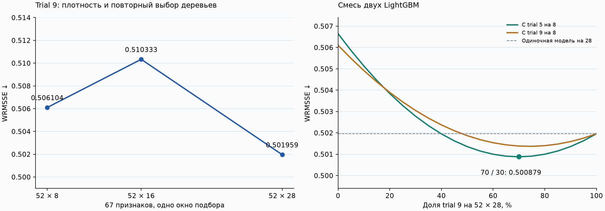

# LightGBM: плотность и ансамбли

Окно подбора: **28 марта — 24 апреля 2016 года**, дата отсчёта — 27 марта. Все варианты LightGBM используют 67 принятых признаков. Это исторические оценки разработки; серверная оценка Kaggle не получена.

## Основные результаты

| Вариант | Плотность | Деревьев | WRMSSE ↓ | Bias |
|---|---:|---:|---:|---:|
| Trial 9 | 52 × 8 | 321 | 0.506104 | −0.25% |
| Trial 5 | 52 × 8 | 471 | 0.506647 | −1.04% |
| Trial 9 | 52 × 16 | 210 | 0.510333 | −0.39% |
| Trial 5 | 52 × 16 | 264 | 0.511518 | −0.68% |
| Trial 9 | 52 × 28 | 197 | 0.501959 | −0.29% |
| **Смесь LightGBM 70 / 30** | **28 + 8** | **197 + 471** | **0.500879** | **−0.52%** |

Плотность 16 ухудшила обе конфигурации; плотность 28 улучшила Trial 9 на 0.82% относительно 8. Число деревьев на новой плотности выбиралось заново. На 28 построены 44 393 440 обучающих строк; подготовка заняла 192 секунды, fit — 2254 секунды в сохранённом запуске. Это время конкретной Kaggle-сессии.

Точная оценка одиночной модели — **0.5019588456962026**, лучшей смеси — **0.500879332781371**. Смесь: 70% Trial 9 на 28 и 30% Trial 5 на 8. Снижение WRMSSE к одиночной модели — 0.215%. CatBoost 52 × 2 имел WRMSSE 0.5660526161; при проверке двух троек на сетке 5% его лучший вес оказался нулевым. Улучшения сверх пары не найдено.

## Переносимость плотности 8

| Период | Контроль ↓ | Trial 9 ↓ | Trial 5 ↓ |
|---|---:|---:|---:|
| 1–28 февраля | 0.764329 | **0.728815** | 0.752058 |
| 29 февраля — 27 марта | 0.672673 | 0.670937 | **0.665074** |

Деревья фиксировались до оценки: 386 / 321 / 471. Средний относительный выигрыш по двум окнам — 2.45% у Trial 9 и 1.37% у Trial 5. Полные протоколы этих проверок и плотности 16 в последнем checkpoint не сохранились. Таблицы переписаны с [исходных скриншотов](evidence_sources.json) с показанной точностью. Модель 28 и ансамбль на этих двух окнах пока не проверены.

## Содержимое

- [experiment_summary.csv](experiment_summary.csv) — сводка и источник каждого числа.
- [density28_2016-03-27_52x28_trial_009](density28_2016-03-27_52x28_trial_009) — точные параметры, метрики, 1456 пар дат, важности и кривая обучения.
- [ensemble_pairs_v1](ensemble_pairs_v1) — перебор попарных весов и выбранная смесь.
- [ensemble_three_v1](ensemble_three_v1) — 462 сочетания весов двух троек с CatBoost.
- [historical_checks_from_screenshot.csv](historical_checks_from_screenshot.csv) и [density16_from_screenshot.csv](density16_from_screenshot.csv) — результаты со скриншотов.
- [checkpoint_inventory.json](checkpoint_inventory.json) — хеши всех 32 файлов исходного checkpoint и их размещение локально.
- [preservation_check.json](preservation_check.json) — проверка сохранения кода и выводов при оформлении.

Модели и полные `predictions.csv.gz` сохранены локально и исключены из Git. В Git идут небольшие отчёты, исходные скриншоты и график. Два gzip из старого Optuna отличаются от местных только сжатием: распакованные CSV совпадают. Исходные местные файлы сохранены; точные копии пришедших gzip есть среди источников ансамбля.

## Следующий шаг

Optuna на 52 × 28 с теми же 67 признаками; затем сравнение кандидатов и пересмотр весов ансамбля. Общую калибровку можно исследовать сейчас, но окончательный коэффициент выбираем после модели и весов. Он должен улучшать WRMSSE, а не только устранять Bias. Новая модель на public и итоговом периоде пока не оценена.

Код — [ноутбук 06](../../../notebooks/06_validation_and_density.ipynb), порядок работы — [инструкция](../../../docs/validation_and_density.md). При оформлении эксперименты не запускались заново.
