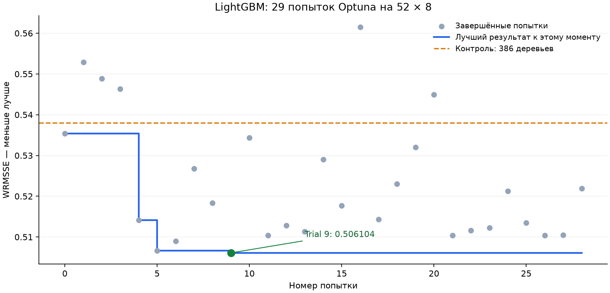

# LightGBM Optuna: 52 × 8, 67 признаков

Сохранён итоговый checkpoint Kaggle от 25 октября 2026 года: **29 завершённых попыток**, все в состоянии COMPLETE. Целевой бюджет истории — 40 попыток. Дополнительные обучения при переносе файлов не выполнялись.

Окно подбора: **28 марта — 24 апреля 2016 года**. Train содержит 12 683 840 строк; validation — 853 720. Функция потерь — Tweedie, выбор деревьев и параметров — по WRMSSE на 12 уровнях. Верхний лимит — 1600 деревьев, ожидание без улучшения — 200 итераций.

| Вариант | WRMSSE | Bias | Деревьев |
|---|---:|---:|---:|
| Контроль, 386 деревьев | 0.538018 | −1.26% | 386 |
| Trial 0, текущие параметры и ранняя остановка | 0.535402 | −1.19% | 331 |
| **Trial 9** | **0.506104** | **−0.25%** | **321** |
| Trial 5 | 0.506647 | −1.04% | 471 |

Улучшение Trial 9 к фиксированному контролю — **5.93%**. Результат получен на окне подбора и пока не подтверждён на других периодах или плотностях. Официальный Kaggle score не получен.

## Файлы

- [trials.csv](trials.csv) — все 29 попыток с параметрами, качеством и временем.
- [comparison.csv](comparison.csv) — точное сравнение лучшего результата с фиксированным контролем.
- [finalists.json](finalists.json) — полные параметры Trial 9 и Trial 5.
- [study_manifest.json](study_manifest.json) — зафиксированные версии, хеши исходных CSV и протокол поиска.
- [run_status.json](run_status.json) — итоговое состояние истории.
- [training_plan.csv](training_plan.csv) — пары дат и горизонтов.
- Папки `trial_000`–`trial_028` — протоколы, кривые качества, важности и результаты по уровням; `baseline_386` — фиксированный контроль.

Все исходные CSV и JSON из checkpoint скопированы без изменения байтов. Веса двух финалистов, модель контроля, SQLite и полные прогнозы сохранены локально в проекте и исключены из Git. Исходная папка checkpoint в `pet_projects` не изменялась.

## Ноутбук и воспроизводимость

[05_optuna_cpu.ipynb](../../../notebooks/05_optuna_cpu.ipynb) содержит самостоятельный запуск и отдельную Markdown-таблицу сохранённых результатов. Исходный локальный экспорт не содержал выполненных code outputs. Перед коммитом синхронизированы 40 попыток и ожидание 200 итераций; мягкий бюджет 10 часов взят из согласованных настроек, отдельно в checkpoint он не записан. Логика остальных 25 ячеек кода сохранена по AST. Старые численные outputs к изменённому коду не добавлялись.

Перед отправкой проверены структура ноутбука, синтаксис, соответствие CSV протоколам, значение WRMSSE выбранных итераций в кривых качества, целостность SQLite и хеши перенесённых файлов. Эти проверки не включали новое обучение или прогнозирование.

Следующий шаг — сравнение финалистов на 52 × 16, проверка переносимости на других исторических окнах и затем 52 × 28. Ансамбль и калибровка ещё не выполнены.
